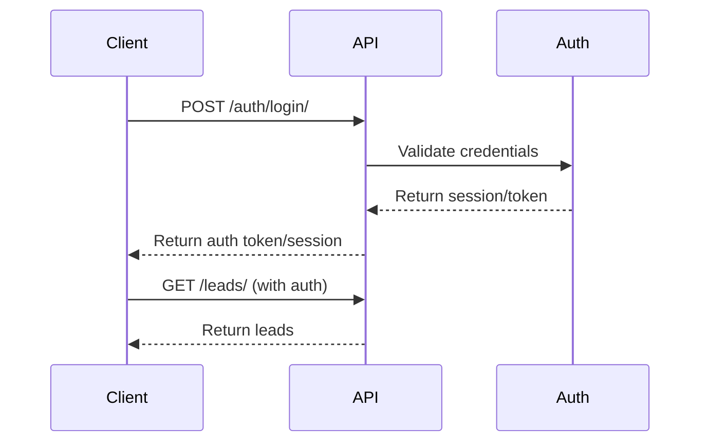

# API Documentation

## Base URL

- **Development**: `http://localhost:8000/api/v1`
- **Production**: `https://your-domain.com/api/v1`

## Authentication

Most admin endpoints require authentication. The API uses Django session authentication or token authentication.



## API Endpoints

### Chat Endpoints

#### Create Session
```http
POST /chat/sessions/
```

**Request Body:**
```json
{
  "source_url": "https://example.com/page",
  "utm_source": "google",
  "utm_medium": "cpc",
  "utm_campaign": "wedding"
}
```

**Response:**
```json
{
  "id": "uuid",
  "session_id": "uuid",
  "status": "active",
  "created_at": "2026-10-27T13:29:00Z",
  "lead": {
    "id": 1,
    "full_name": null,
    "phone_number": null,
    "qualification_level": "cold"
  }
}
```

#### Get Session
```http
GET /chat/sessions/{session_id}/
```

#### Send Message
```http
POST /chat/sessions/{session_id}/messages/
```

**Request Body:**
```json
{
  "message": "Hello, I need wedding planning help"
}
```

**Response:**
```json
{
  "user_message": {
    "id": 1,
    "role": "user",
    "content": "Hello...",
    "created_at": "2026-10-27T13:29:00Z"
  },
  "assistant_message": {
    "id": 2,
    "role": "assistant",
    "content": "What's your full name?",
    "created_at": "2026-10-27T13:29:01Z"
  },
  "lead": {
    "id": 1,
    "full_name": null,
    "score": 0,
    "qualification_level": "cold"
  },
  "next_question": "What's your full name?"
}
```

#### Get Messages
```http
GET /chat/sessions/{session_id}/messages/
```

#### End Session
```http
POST /chat/sessions/{session_id}/end/
```

### Lead Endpoints (Admin)

#### List Leads
```http
GET /leads/
```

**Query Parameters:**
- `qualification_level` - hot, warm, cold
- `status` - new, contacted, converted, lost
- `search` - search by name/phone
- `ordering` - created_at, score

**Response:**
```json
{
  "count": 100,
  "next": null,
  "previous": null,
  "results": [
    {
      "id": 1,
      "full_name": "John Doe",
      "phone_number": "+919876543210",
      "email": null,
      "wedding_location": "Jaipur",
      "wedding_date": "2026-12-01",
      "guest_count": "200",
      "budget_range_text": "₹30-40 lakhs",
      "required_services": ["Venue", "Decor"],
      "score": 75,
      "qualification_level": "hot",
      "status": "new",
      "consultation_requested": true,
      "created_at": "2026-10-27T13:29:00Z"
    }
  ]
}
```

#### Get Lead
```http
GET /leads/{id}/
```

#### Update Lead
```http
PATCH /leads/{id}/
```

**Request Body:**
```json
{
  "status": "contacted",
  "notes": "Called, interested in venue"
}
```

#### Recalculate Lead Score
```http
POST /leads/{id}/recalculate/
```

### Chat Logs (Admin)
```http
GET /chat/logs/
GET /chat/logs/{session_id}/
```

### Knowledge Base (Admin)
```http
GET /knowledge/
POST /knowledge/
PATCH /knowledge/{id}/
DELETE /knowledge/{id}/
```

### Settings (Admin)
```http
GET /settings/
PATCH /settings/
```

## Response Codes

| Code | Description |
|------|-------------|
| 200 | Success |
| 201 | Created |
| 400 | Bad Request |
| 401 | Unauthorized |
| 403 | Forbidden |
| 404 | Not Found |
| 500 | Internal Server Error |

## Error Response Format
```json
{
  "error": "Error message description",
  "details": {}
}
```

## Rate Limiting

Currently not implemented but can be added for production. Recommended limits:
- Chat messages: 30 per minute per session
- Session creation: 10 per minute per IP
- Admin endpoints: 100 per minute per user

## CORS Policy

Configured via `django-cors-headers`. Widget and frontend origins must be whitelisted.

## Webhook Support

Not currently implemented. Can be added for CRM integration.
