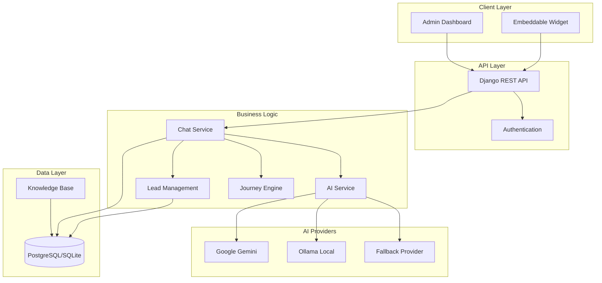
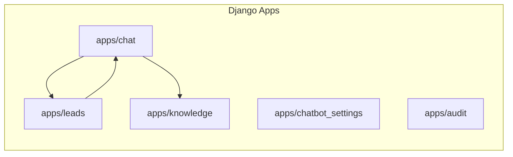
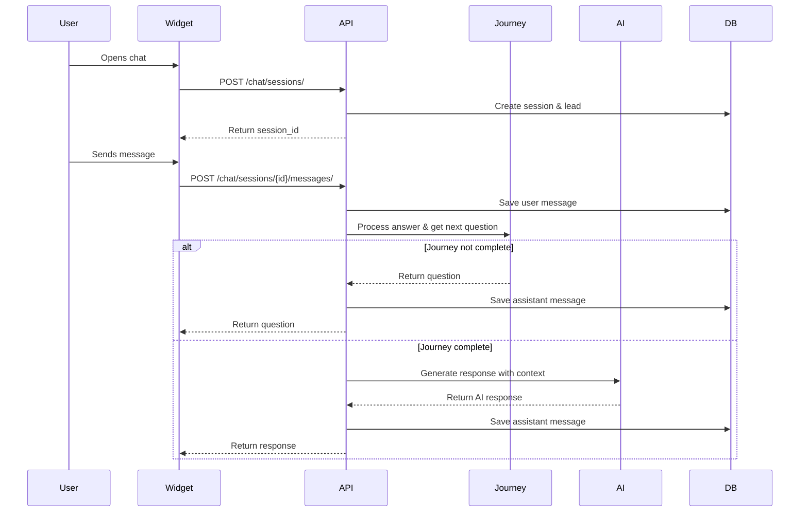
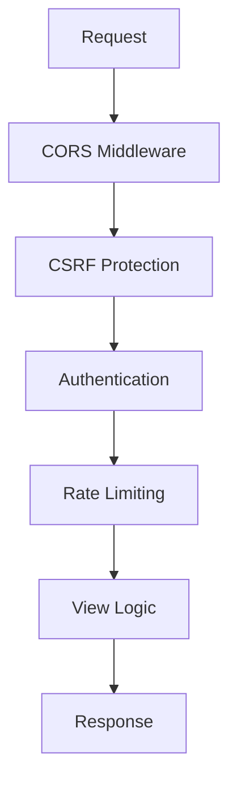
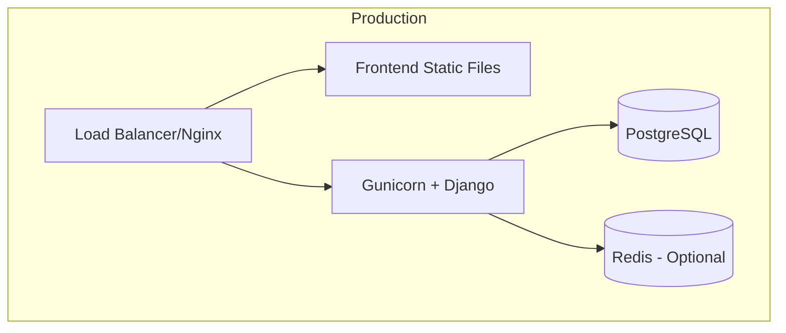

# Architecture

## System Overview

The IWP Chatbot follows a modern three-tier architecture with clear separation of concerns between the frontend, backend, and AI services.

## High-Level Architecture Diagram

## Component Architecture

### 1. Frontend Layer

#### Admin Dashboard (React + Vite)
- **Purpose**: Management interface for chats, leads, knowledge base, and settings
- **Port**: 5173 (dev) / served via Nginx (prod)
- **Features**: Real-time chat monitoring, lead tracking, analytics
- **State Management**: React hooks and context
- **Routing**: React Router DOM
- **Styling**: Tailwind CSS

#### Embeddable Widget (React + Vite)
- **Purpose**: Customer-facing chat interface
- **Build**: IIFE bundle for script tag embedding
- **Features**: Session management, message handling, responsive design
- **Integration**: Can be embedded on any website

### 2. Backend Layer (Django REST Framework)

#### Core Apps

- **chat**: Session management, messaging, AI integration, conversation flow
- **leads**: Lead capture, scoring, qualification, management
- **knowledge**: FAQ and business information repository
- **chatbot_settings**: Configuration and scoring rules
- **audit**: Activity logging and audit trails

### 3. Data Flow Architecture

## Design Patterns

### 1. Provider Pattern (AI Services)
The AI service uses a provider pattern for flexibility and fallback:
- `AIProvider` (abstract base class)
- `GeminiProvider`, `OllamaProvider`, `FallbackProvider`
- `AIService` orchestrates provider selection

### 2. State Machine Pattern (Conversation Flow)
The conversation follows a state-driven approach:
- Journey states track lead collection progress
- Automatic progression through questions
- State persistence in database

### 3. Repository Pattern
Data access is abstracted through Django ORM models with clear relationships.

### 4. Strategy Pattern (Scoring)
Lead scoring uses a configurable `LeadScoringEngine` with weights and thresholds sourced from `ScoringConfig` in the database (falling back to sensible defaults). The engine normalizes weights so their maximum possible total is 100, computes per-factor awarded points, and persists them as `LeadScoreEvent` records. This keeps the score and the Score Breakdown UI perfectly in sync on every recalculation.

## Scalability Considerations

- **Stateless API**: RESTful design allows horizontal scaling
- **Database**: Can use PostgreSQL for production, SQLite for development
- **Caching**: Can be added with Redis for sessions and responses
- **Async Processing**: Celery can be integrated for background tasks (summaries, emails)
- **CDN**: Widget assets can be served via CDN

## Security Architecture

## Performance Considerations

- **Message History**: Limited to last 15 messages for AI context
- **Knowledge Base**: Limited queries to top 3 relevant entries
- **Database Indexes**: Optimized indexes on frequently queried fields
- **Lazy Loading**: Frontend components loaded as needed
- **Bundle Optimization**: Vite for fast builds and code splitting

## Integration Points

1. **Website Integration**: Widget via script tag
2. **Admin Access**: Browser-based dashboard
3. **AI Services**: External APIs (Gemini) or local (Ollama)
4. **Database**: PostgreSQL/SQLite

## Deployment Architecture

