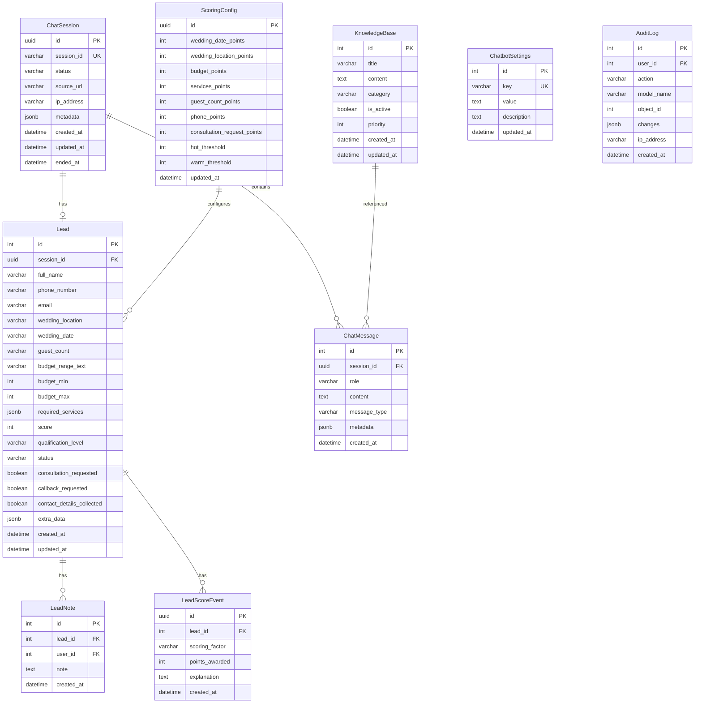

# Database Schema

## Overview

The database uses Django ORM with models across multiple apps. PostgreSQL is recommended for production, SQLite for development.

## Entity Relationship Diagram



## Model Details

### ChatSession (apps.chat.models)
Represents a conversation session.

| Field | Type | Description |
|-------|------|-------------|
| id | UUID (PK) | Primary key |
| session_id | UUID (Unique) | Public session identifier |
| status | CharField | active, ended, abandoned |
| source_url | URLField | Referrer URL |
| ip_address | GenericIPAddressField | Client IP |
| user_agent | TextField | Browser info |
| metadata | JSONField | Additional data (UTM, etc.) |
| actions_taken | JSONField | Actions performed during session |
| created_at | DateTimeField | Creation timestamp |
| updated_at | DateTimeField | Last update |
| ended_at | DateTimeField | Session end time |

### Lead (apps.leads.models)
Stores lead information and scoring.

| Field | Type | Description |
|-------|------|-------------|
| id | AutoField (PK) | Primary key |
| session | OneToOneField | Related ChatSession |
| full_name | CharField | Lead's full name |
| phone_number | CharField | Contact number (normalized) |
| email | EmailField | Email address (optional) |
| wedding_location | CharField | Wedding city/location |
| wedding_date | CharField | Preferred date |
| guest_count | CharField | Number of guests |
| budget_range_text | CharField | Budget description |
| budget_min | IntegerField | Min budget |
| budget_max | IntegerField | Max budget |
| required_services | JSONField | List of services needed |
| score | IntegerField | Lead score (0-100) |
| qualification_level | CharField | hot/warm/cold |
| status | CharField | new/contacted/qualified/proposal_sent/converted/lost |
| consultation_requested | BooleanField | Consultation requested flag |
| callback_requested | BooleanField | Callback requested flag |
| contact_details_collected | BooleanField | Has contact info |
| source | CharField | Lead source |
| assigned_to | ForeignKey(User) | Assigned admin user |
| extra_data | JSONField | Additional fields |
| created_at | DateTimeField | Creation time |
| updated_at | DateTimeField | Last update |

### ChatMessage (apps.chat.models)
Individual messages in a conversation.

| Field | Type | Description |
|-------|------|-------------|
| id | AutoField (PK) | Primary key |
| session | ForeignKey | Related ChatSession |
| role | CharField | user/assistant/system |
| content | TextField | Message content |
| message_type | CharField | text/quick_reply/etc |
| metadata | JSONField | Additional data |
| created_at | DateTimeField | Timestamp |

### KnowledgeBase (apps.knowledge.models)
Business knowledge for AI responses.

| Field | Type | Description |
|-------|------|-------------|
| id | AutoField (PK) | Primary key |
| title | CharField | Entry title |
| content | TextField | Information content |
| category | CharField | Category grouping |
| is_active | BooleanField | Active status |
| priority | IntegerField | Priority for retrieval |
| created_at | DateTimeField | Creation time |
| updated_at | DateTimeField | Last update |

### LeadNote (apps.leads.models)
Notes added by admins to leads.

| Field | Type | Description |
|-------|------|-------------|
| id | AutoField (PK) | Primary key |
| lead | ForeignKey | Related Lead |
| user | ForeignKey(User) | Admin who added note |
| note | TextField | Note content |
| created_at | DateTimeField | Timestamp |

### LeadScoreEvent (apps.leads.models)
Immutable per-factor scoring records that power the Score Breakdown UI.

| Field | Type | Description |
|-------|------|-------------|
| id | UUID (PK) | Primary key |
| lead | ForeignKey | Related Lead |
| scoring_factor | CharField | Factor name (e.g. budget, phone) |
| points_awarded | IntegerField | Points awarded for this factor |
| explanation | TextField | Human-readable reason |
| created_at | DateTimeField | Timestamp |

Each lead's score events are recalculated together with the lead score, so the sum of `points_awarded` always equals `lead.score` (max 100).

### ScoringConfig (apps.chatbot_settings.models)
Admin-configurable lead scoring weights and qualification thresholds.

| Field | Type | Default | Description |
|-------|------|---------|-------------|
| id | UUID (PK) | - | Primary key |
| wedding_date_points | IntegerField | 15 | Wedding date factor |
| wedding_location_points | IntegerField | 10 | Location factor |
| budget_points | IntegerField | 20 | Budget factor |
| services_points | IntegerField | 15 | Services factor |
| guest_count_points | IntegerField | 10 | Guest count factor (scaled 5-10) |
| phone_points | IntegerField | 15 | Phone factor |
| consultation_request_points | IntegerField | 10 | Consultation/callback factor |
| hot_threshold | IntegerField | 70 | Hot qualification threshold |
| warm_threshold | IntegerField | 40 | Warm qualification threshold |
| updated_at | DateTimeField | - | Last update |

Full Name contributes a fixed 5 points. Configured weights are proportionally normalized by the scoring engine if their total exceeds 100. Defaults total exactly 100 (including Full Name).

### ChatbotSettings (apps.chatbot_settings.models)
Configurable settings.

| Field | Type | Description |
|-------|------|-------------|
| id | AutoField (PK) | Primary key |
| key | CharField (Unique) | Setting key |
| value | TextField | Setting value (JSON/string) |
| description | TextField | Setting description |
| updated_at | DateTimeField | Last update |

### AuditLog (apps.audit.models)
Audit trail for admin actions.

| Field | Type | Description |
|-------|------|-------------|
| id | AutoField (PK) | Primary key |
| user | ForeignKey(User) | User who performed action |
| action | CharField | Action type |
| model_name | CharField | Affected model |
| object_id | IntegerField | Affected object ID |
| changes | JSONField | What changed |
| ip_address | GenericIPAddressField | User IP |
| created_at | DateTimeField | Timestamp |

## Indexes

Recommended indexes for performance:

```sql
-- ChatSession
CREATE INDEX idx_session_status ON chat_chatsession(status);
CREATE INDEX idx_session_created ON chat_chatsession(created_at);

-- Lead
CREATE INDEX idx_lead_score ON leads_lead(score DESC);
CREATE INDEX idx_lead_qual ON leads_lead(qualification_level);
CREATE INDEX idx_lead_status ON leads_lead(status);
CREATE INDEX idx_lead_phone ON leads_lead(phone_number);
CREATE INDEX idx_lead_created ON leads_lead(created_at);

-- ChatMessage
CREATE INDEX idx_msg_session ON chat_chatmessage(session_id);
CREATE INDEX idx_msg_created ON chat_chatmessage(created_at);
```

## Data Migrations

Migrations are managed by Django's migration system. Key migrations track schema evolution.

## Backup Strategy

For production:
1. Daily automated backups of PostgreSQL
2. Point-in-time recovery capability
3. Store backups off-site
4. Test restore procedures regularly
