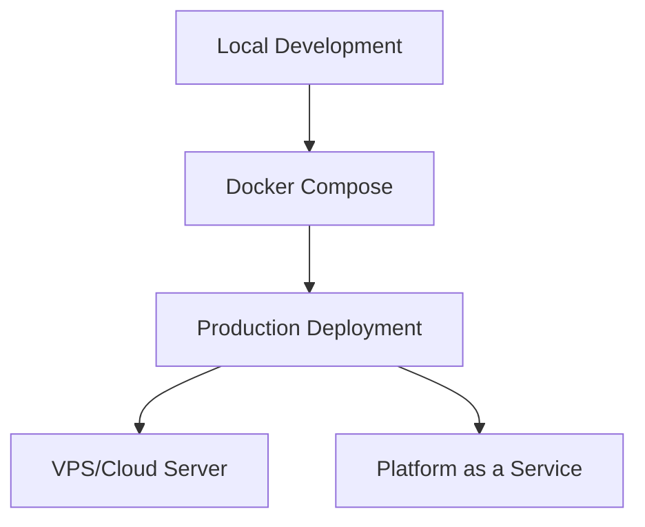

# Deployment Guide

## Overview

This guide covers deployment options for the IWP Chatbot, from local development to production environments.

## Deployment Options



## Prerequisites

- Linux/Unix server (Ubuntu recommended)
- Docker and Docker Compose installed
- Domain name (optional but recommended)
- SSL certificate (Let's Encrypt)
- PostgreSQL (or use SQLite for small deployments)
- API keys for AI providers (Gemini)

## Docker Deployment (Recommended)

### 1. Clone Repository
```bash
git clone <repository-url>
cd iwp-chatbot
```

### 2. Configure Environment Variables

Create `.env` files for each service:

#### Backend `.env`
```env
DEBUG=False
SECRET_KEY=your-super-secret-key-here
ALLOWED_HOSTS=your-domain.com,localhost
DATABASE_URL=postgresql://user:password@db:5432/iwp_chatbot
GEMINI_API_KEY=your-gemini-api-key
AI_MODEL_NAME=gemini-3.5-flash-lite
CORS_ALLOWED_ORIGINS=https://your-domain.com
```

#### Frontend/Admin
```env
VITE_API_URL=https://api.your-domain.com/api/v1
```

#### Widget
```env
VITE_API_URL=https://api.your-domain.com/api/v1
```

### 3. Docker Compose Setup

The `docker-compose.yml` includes:
- PostgreSQL database
- Django backend
- Nginx reverse proxy (optional)
- Frontend and widget builds

```bash
docker-compose up -d
```

### 4. Run Migrations and Create Superuser
```bash
docker-compose exec backend python manage.py migrate
docker-compose exec backend python manage.py createsuperuser
docker-compose exec backend python manage.py collectstatic --noinput
```

## Manual Deployment

### Backend Deployment

#### 1. Setup Environment
```bash
cd backend
python -m venv venv
source venv/bin/activate
pip install -r requirements.txt
```

#### 2. Configure Settings
```bash
cp .env.example .env
# Edit .env with production values
```

#### 3. Database Setup
```bash
python manage.py migrate
python manage.py createsuperuser
python manage.py collectstatic
```

#### 4. Run with Gunicorn
```bash
gunicorn config.wsgi:application --bind 0.0.0.0:8000 --workers 3
```

### Frontend Deployment

#### Admin Dashboard
```bash
cd frontend
npm install
npm run build
# Serve dist/ with Nginx
```

#### Widget
```bash
cd widget
npm install
npm run build
# Deploy dist/iwp-chatbot.iife.js
```

## Nginx Configuration

```nginx
server {
    listen 80;
    server_name your-domain.com;
    return 301 https://$server_name$request_uri;
}

server {
    listen 443 ssl;
    server_name your-domain.com;
    
    ssl_certificate /path/to/cert.pem;
    ssl_certificate_key /path/to/key.pem;
    
    # Admin Dashboard
    location / {
        root /var/www/frontend/dist;
        try_files $uri $uri/ /index.html;
    }
    
    # API
    location /api/ {
        proxy_pass http://127.0.0.1:8000;
        proxy_set_header Host $host;
        proxy_set_header X-Real-IP $remote_addr;
        proxy_set_header X-Forwarded-For $proxy_add_x_forwarded_for;
        proxy_set_header X-Forwarded-Proto $scheme;
    }
    
    # Static files
    location /static/ {
        alias /var/www/backend/staticfiles/;
    }
    
    # Media files
    location /media/ {
        alias /var/www/backend/media/;
    }
    
    # Widget
    location /widget/ {
        alias /var/www/widget/dist/;
    }
}
```

## Production Checklist

### Security
- [ ] Set `DEBUG=False`
- [ ] Use strong `SECRET_KEY`
- [ ] Configure `ALLOWED_HOSTS`
- [ ] Enable HTTPS/SSL
- [ ] Set secure CORS origins
- [ ] Configure CSRF settings
- [ ] Use environment variables for secrets
- [ ] Enable security headers

### Database
- [ ] Use PostgreSQL in production
- [ ] Setup database backups
- [ ] Configure connection pooling
- [ ] Run migrations

### Performance
- [ ] Enable gzip compression
- [ ] Configure static file caching
- [ ] Use CDN for widget assets
- [ ] Setup monitoring (optional)
- [ ] Configure logging

### AI Configuration
- [ ] Add valid Gemini API key
- [ ] Test AI provider fallback
- [ ] Configure rate limits if needed

## Monitoring & Maintenance

### Health Checks
```bash
# Backend health
curl https://api.your-domain.com/api/v1/health/

# Check services
docker-compose ps
```

### Logs
```bash
# Backend logs
docker-compose logs -f backend

# Nginx logs
tail -f /var/log/nginx/access.log
tail -f /var/log/nginx/error.log
```

### Backups
```bash
# Database backup
docker-compose exec db pg_dump -U user iwp_chatbot > backup.sql

# Restore
docker-compose exec -T db psql -U user iwp_chatbot < backup.sql
```

## Scaling Considerations

### Horizontal Scaling
- Use load balancer (Nginx/HAProxy)
- Multiple backend instances with Gunicorn
- Shared PostgreSQL database
- Redis for session/cache storage

### Performance Optimization
- Enable Django caching
- Use database query optimization
- Implement API rate limiting
- Add CDN for static assets
- Compress responses

## Troubleshooting

### Common Issues

**CORS Errors**
- Check `CORS_ALLOWED_ORIGINS` in backend settings
- Ensure frontend URL is whitelisted

**Static Files Not Loading**
- Run `collectstatic`
- Check Nginx static file configuration
- Verify file permissions

**Database Connection Issues**
- Check database credentials
- Ensure database is running
- Verify network connectivity

**AI Not Responding**
- Check API keys
- Verify provider availability
- Check fallback is working

## Support & Resources

- [Django Deployment Checklist](https://docs.djangoproject.com/en/stable/howto/deployment/checklist/)
- [Nginx Documentation](https://nginx.org/en/docs/)
- [Docker Documentation](https://docs.docker.com/)
