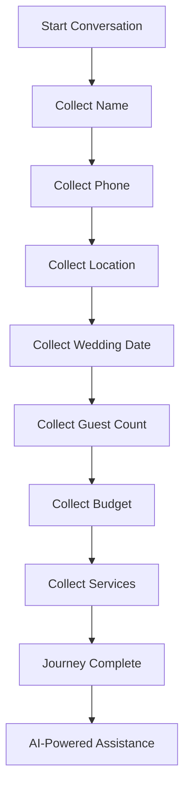
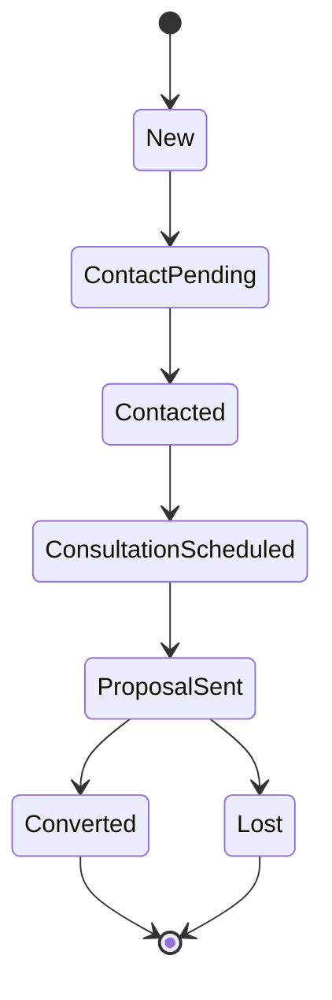

# Features

## Core Features

### 1. Embeddable Chatbot Widget
- **Script Tag Integration**: Easy embedding on any website
- **Responsive Design**: Works on desktop and mobile devices
- **Customizable Positioning**: Bottom-right or bottom-left placement
- **Minimizable Interface**: Can be minimized when not in use
- **Session Persistence**: Maintains conversation across page loads
- **Real-time Messaging**: Instant message delivery

### 2. AI-Powered Conversations
- **Multi-Provider Support**: Google Gemini, Ollama (local), and intelligent fallback
- **Context-Aware Responses**: Uses lead data and conversation history
- **Knowledge Base Integration**: Grounds responses in verified business information
- **Natural Language Processing**: Understands user intent
- **Polite Handling**: Gracefully handles complaints and abuse
- **Concise Responses**: Optimized for quick, helpful answers

### 3. Intelligent Lead Capture
- **Conversational Collection**: Gathers information naturally through dialogue
- **Progressive Profiling**: Collects data step by step
- **Data Validation**: Validates phone numbers, names, and inputs
- **Automatic Lead Creation**: Creates lead record on first interaction
- **Duplicate Prevention**: One lead per session

### 4. Smart Journey Flow
- **State Machine**: Manages conversation progression
- **Question Sequencing**: Asks relevant questions in logical order
- **Skip Logic**: Doesn't re-ask already answered questions
- **Completion Detection**: Recognizes when all required info is collected
- **Flexible Input Handling**: Accepts various formats (dates, budgets, etc.)

### 5. Lead Scoring & Qualification
- **Automatic Scoring**: 0-100 point scale, hard-capped at 100
- **Default Weighted Factors** (total = 100):
  - Full Name: 5 points (fixed)
  - Wedding Date: 15 points
  - Wedding Location: 10 points
  - Budget: 20 points
  - Services: 15 points
  - Guest Count: 5-10 points (scaled by guest size; 100+ guests = full 10)
  - Phone Number: 15 points
  - Consultation/Callback Request: 10 points
- **Configurable Weights**: Admin can tune weights in Settings. Configured weights are normalized proportionally if they exceed 100, so each factor keeps its relative importance while the total never exceeds 100.
- **Consistent Breakdown**: Score events store the actual awarded points per factor and are recalculated on every scoring pass, so the breakdown always sums exactly to the lead score. The Score Breakdown UI shows each factor sorted by points plus the total.
- **Qualification Levels**:
  - Hot: >= 70 points
  - Warm: 40-69 points
  - Cold: < 40 points
- **Score Tracking**: Audit trail of scoring events with awarded points and explanations

### 6. Admin Dashboard
- **Dashboard Overview**: Key metrics at a glance
  - Total conversations
  - Total leads
  - Hot/Warm/Cold lead distribution
  - Active chats
- **Chat Logs**: View all conversations with transcripts
- **Lead Management**: 
  - View all leads with filters
  - Update lead status
  - Add notes and follow-ups
  - Track qualification and scoring
- **Knowledge Base**: Manage FAQs and business information
- **Settings**: Configure chatbot behavior and scoring rules
- **User Authentication**: Secure admin access

### 7. Conversation Management
- **Session Tracking**: Monitor active, completed, abandoned sessions
- **Message History**: Complete conversation transcripts
- **Inactivity Detection**: Auto-end sessions after 10 minutes of inactivity
- **Conversation Summaries**: AI-generated summaries (with fallback)
- **Source Tracking**: Track referrer URLs and campaign data

### 8. Knowledge Base System
- **FAQ Management**: Add/edit business information
- **Category Organization**: Organize by topic
- **Active/Inactive Toggle**: Control what's used by AI
- **Context Injection**: Automatically included in AI responses

## Advanced Features

### 9. Smart Response Handling
- **Intent Detection**: Understands user queries (pricing, services, locations)
- **Location Intelligence**: Recognizes Indian cities and wedding destinations
- **Service Recognition**: Identifies wedding service requirements
- **Budget Parsing**: Understands budget mentions (lakhs, crores)
- **Guest Count Extraction**: Parses numeric guest counts

### 10. Lead Lifecycle Management

### 11. Security Features
- **CSRF Protection**: Django CSRF middleware
- **CORS Configuration**: Controlled cross-origin access
- **Authentication**: Token/session-based auth for admin
- **Input Validation**: Sanitization and validation
- **Rate Limiting**: Can be configured
- **Secure Headers**: Security middleware enabled

### 12. Analytics & Reporting
- **Lead Metrics**: Conversion tracking by qualification
- **Conversation Analytics**: Message counts, session duration
- **Source Attribution**: Track where leads come from
- **Score Distribution**: Visualize lead quality

## Feature Matrix

| Feature | Widget | Admin | Status |
|---------|--------|-------|--------|
| Real-time Chat | ✓ | ✓ | Active |
| Lead Capture | ✓ | ✓ | Active |
| AI Responses | ✓ | - | Active |
| Journey Flow | ✓ | - | Active |
| Lead Scoring | ✓ | ✓ | Active |
| Chat History | ✓ | ✓ | Active |
| Knowledge Base | - | ✓ | Active |
| User Management | - | ✓ | Active |
| Analytics | - | ✓ | Active |
| Settings | - | ✓ | Active |

## User Experience Features

- **Fast Response Time**: Optimized for quick interactions
- **Mobile Responsive**: Works seamlessly on all devices
- **Minimal UI**: Clean, focused interface
- **Error Handling**: Graceful error messages
- **Loading States**: Clear feedback during operations
- **Accessibility**: Semantic HTML and keyboard navigation
