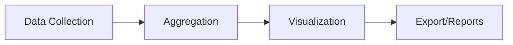
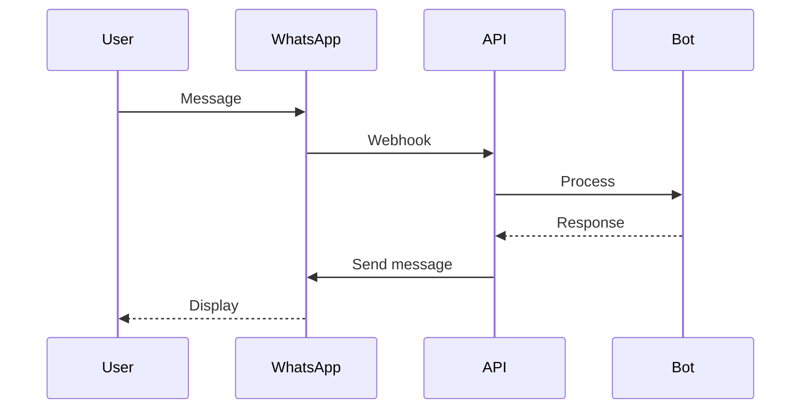

# Future Improvements

## Roadmap

This document outlines planned enhancements and future development directions for the IWP Chatbot.

## Short-term Improvements (1-2 Months)

### 1. Enhanced Analytics Dashboard
- **Lead Conversion Funnel**: Visualize conversion rates at each stage
- **Traffic Source Analytics**: Track leads by referrer/UTM
- **Response Time Metrics**: Monitor chatbot performance
- **Heatmaps**: User interaction patterns
- **Export Reports**: PDF/CSV export functionality

### 2. CRM Integration
- **HubSpot**: Sync leads to HubSpot CRM
- **Salesforce**: Enterprise CRM integration
- **Zoho CRM**: Popular in Indian market
- **Pabbly/Make.com**: Webhook automation
- **Custom Webhooks**: Flexible integration options

### 3. Multi-language Support
- **Hindi**: Primary Indian language
- **Gujarati**: For Gujarat market
- **Punjabi**: North India
- **Auto-detection**: Detect user language
- **Translation**: AI-powered translation

### 4. Improved AI Capabilities
- **Function Calling**: Better tool use by AI
- **RAG Enhancement**: Better knowledge base retrieval
- **Sentiment Analysis**: Detect customer mood
- **Intent Classification**: More accurate routing
- **Personalization**: Tailored responses

## Mid-term Improvements (3-6 Months)

### 5. WhatsApp Integration
- **WhatsApp Business API**: Direct WhatsApp messaging
- **Template Messages**: Automated follow-ups
- **Media Support**: Images, documents
- **Two-way Sync**: Sync with web chat
- **Chatbot on WhatsApp**: Expand reach

### 6. Appointment Scheduling
- **Calendar Integration**: Google Calendar, Calendly
- **Availability Management**: Set time slots
- **Automated Booking**: Book consultations
- **Reminders**: SMS/Email reminders
- **Rescheduling**: Easy reschedule/cancel

### 7. Advanced Lead Scoring
- **Machine Learning**: ML-based scoring model
- **Behavioral Tracking**: Time on site, pages visited
- **Engagement Scoring**: Message frequency, response time
- **Predictive Analytics**: Conversion probability
- **A/B Testing**: Optimize scoring weights

### 8. Email & SMS Notifications
- **Lead Alerts**: Instant notifications to sales team
- **Follow-up Reminders**: Automated reminders
- **Email Campaigns**: Nurture campaigns
- **SMS Integration**: Twilio/MSG91
- **Drip Sequences**: Automated follow-ups

## Long-term Improvements (6-12 Months)

### 9. Voice Integration
- **Voice Chat**: Voice input/output
- **AI Voice Assistant**: Natural conversation
- **Multi-modal**: Text + voice + images
- **Transcription**: Voice to text

### 10. Mobile App
- **Admin Mobile App**: iOS/Android for admins
- **Push Notifications**: Real-time alerts
- **Offline Support**: Basic functionality offline
- **Lead Management on Go**: Mobile-optimized

### 11. Advanced Features
- **Virtual Wedding Planner**: Comprehensive planning assistant
- **Budget Calculator**: Interactive budget tool
- **Vendor Recommendations**: AI-powered vendor matching
- **Gallery Integration**: Show portfolio
- **Price Estimator**: Automated quotes
- **Guest List Manager**: Collaborative tools

### 12. Enterprise Features
- **Multi-tenant**: Support multiple agencies
- **Role-based Permissions**: Granular access control
- **White-labeling**: Custom branding
- **Team Collaboration**: Multiple agents
- **SLA Management**: Response time tracking
- **Advanced Reporting**: Custom reports

## Technical Improvements

### Infrastructure
- **Kubernetes**: Container orchestration at scale
- **Redis Caching**: Improve performance
- **Message Queue**: Celery for background tasks
- **CDN Integration**: Faster asset delivery
- **Monitoring**: Prometheus, Grafana
- **Logging**: ELK stack or similar

### Security Enhancements
- **2FA**: Two-factor authentication
- **OAuth2**: Social login
- **API Key Management**: For integrations
- **Encryption**: End-to-end encryption
- **Security Audit**: Regular audits
- **GDPR Compliance**: Data privacy

### Performance
- **GraphQL API**: More flexible queries
- **WebSocket**: Real-time updates
- **Database Optimization**: Query optimization
- **Image Optimization**: Lazy loading
- **PWA**: Progressive web app capabilities

## Innovation Ideas

### AI-Powered Features
- **Image Recognition**: Analyze wedding inspiration images
- **Style Matching**: Match preferences to portfolio
- **Budget Optimization**: Suggest cost-effective options
- **Timeline Generator**: Auto-generate wedding timeline
- **Chatbot Personality**: Customizable personality

### Integration Ideas
- **Google Analytics**: Enhanced tracking
- **Meta Pixel**: Ad conversion tracking
- **Google Ads**: Lead tracking
- **Payment Gateway**: Online consultation booking/payment
- **Video Calls**: Integrate Zoom/Google Meet

## Priority Matrix

| Improvement | Impact | Effort | Priority |
|-------------|--------|--------|----------|
| CRM Integration | High | Medium | P0 |
| WhatsApp Integration | High | High | P0 |
| Enhanced Analytics | High | Medium | P0 |
| Multi-language | High | High | P1 |
| Appointment Scheduling | High | Medium | P1 |
| ML-based Scoring | Medium | High | P1 |
| Mobile App | Medium | High | P2 |
| Voice Integration | Low | High | P2 |

## Implementation Considerations

- **Backward Compatibility**: Maintain existing functionality
- **Scalability**: Design for growth
- **User Experience**: Don't complicate UI
- **Cost**: Consider API costs
- **Data Privacy**: Compliance with regulations
- **Testing**: Thorough testing for each feature

## Feedback & Suggestions

Future improvements will be driven by:
- User feedback from admins
- Customer usage patterns
- Market trends in wedding industry
- Technology advancements
- Business requirements

---

*This roadmap is subject to change based on priorities and resources.*
