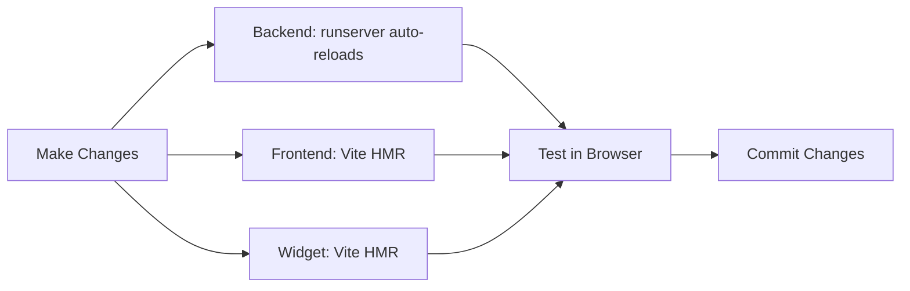

# Setup & Installation

## Prerequisites

Before getting started, ensure you have the following installed:

| Tool | Version | Purpose |
|------|---------|---------|
| Python | 3.11+ | Backend runtime |
| Node.js | 18+ | Frontend/Widget build |
| npm/yarn | Latest | Package management |
| Git | Latest | Version control |
| PostgreSQL | 14+ (optional) | Production database |

## Quick Start (Development)

### 1. Clone the Repository

```bash
git clone <repository-url>
cd iwp-chatbot
```

### 2. Backend Setup

```bash
cd backend

# Create virtual environment
python -m venv venv

# Activate virtual environment
# On Linux/Mac
source venv/bin/activate
# On Windows
# venv\Scripts\activate

# Install dependencies
pip install -r requirements.txt

# Create .env file
cp .env.example .env
```

Edit `backend/.env` with your configuration:

```env
DEBUG=True
SECRET_KEY=dev-secret-key-change-in-production
ALLOWED_HOSTS=localhost,127.0.0.1
CORS_ALLOWED_ORIGINS=http://localhost:5173,http://localhost:5174,http://localhost:3000
GEMINI_API_KEY=your-gemini-api-key-here
AI_MODEL_NAME=gemini-3.5-flash-lite
USE_OLLAMA=False
OLLAMA_BASE_URL=http://localhost:11434
OLLAMA_MODEL=llama3
```

```bash
# Run migrations
python manage.py migrate

# Create superuser
python manage.py createsuperuser

# Load initial data (optional)
# python manage.py loaddata fixtures/initial_data.json

# Run development server
python manage.py runserver
```

Backend will be available at `http://localhost:8000`

### 3. Admin Dashboard Setup

```bash
cd frontend

# Install dependencies
npm install

# Create .env file
cp .env.example .env
```

Edit `frontend/.env`:

```env
VITE_API_URL=http://localhost:8000/api/v1
```

```bash
# Run development server
npm run dev
```

Admin dashboard will be available at `http://localhost:5173`

### 4. Widget Setup

```bash
cd widget

# Install dependencies
npm install

# Create .env file
cp .env.example .env
```

Edit `widget/.env`:

```env
VITE_API_URL=http://localhost:8000/api/v1
```

```bash
# Run development server
npm run dev
```

Widget dev server will be available at `http://localhost:5174`

## Testing the Installation

### 1. Access Admin Dashboard
1. Open `http://localhost:5173`
2. Login with superuser credentials
3. Navigate through Dashboard, Leads, Chat Logs

### 2. Test Widget
Create a test HTML file:

```html
<!DOCTYPE html>
<html lang="en">
<head>
    <meta charset="UTF-8">
    <title>Test Widget</title>
</head>
<body>
    <h1>Test Page</h1>
    <script src="http://localhost:5174/src/main.jsx" type="module"></script>
</body>
</html>
```

Or build and use the IIFE bundle:
```bash
cd widget
npm run build
# Use dist/iwp-chatbot.iife.js
```

### 3. Test API
```bash
# Create a session
curl -X POST http://localhost:8000/api/v1/chat/sessions/ \
  -H "Content-Type: application/json" \
  -d '{"source_url": "http://test.com"}'

# Send a message
curl -X POST http://localhost:8000/api/v1/chat/sessions/<session-id>/messages/ \
  -H "Content-Type: application/json" \
  -d '{"message": "Hello"}'
```

## Development Workflow



## Common Setup Issues

| Issue | Solution |
|-------|----------|
| ModuleNotFoundError | Activate venv and reinstall requirements |
| Port already in use | Kill process or use different port |
| CORS errors | Check CORS_ALLOWED_ORIGINS in backend |
| API key errors | Verify GEMINI_API_KEY is set correctly |
| Migration errors | Delete db.sqlite3 and run migrations again (dev only) |

## Environment Variables Reference

### Backend (.env)
| Variable | Required | Default | Description |
|----------|----------|---------|-------------|
| DEBUG | No | True | Debug mode |
| SECRET_KEY | Yes | - | Django secret key |
| ALLOWED_HOSTS | Yes | localhost | Comma-separated hosts |
| DATABASE_URL | No | sqlite:///db.sqlite3 | Database connection |
| GEMINI_API_KEY | No | - | Google Gemini API key |
| AI_MODEL_NAME | No | gemini-3.5-flash-lite | AI model to use |
| CORS_ALLOWED_ORIGINS | Yes | - | Allowed CORS origins |

### Frontend/Widget (.env)
| Variable | Required | Default | Description |
|----------|----------|---------|-------------|
| VITE_API_URL | Yes | - | Backend API base URL |

## Next Steps

1. Configure AI provider (Gemini or Ollama)
2. Customize chatbot settings in admin panel
3. Add knowledge base entries
4. Test lead capture flow
5. Embed widget on your website
