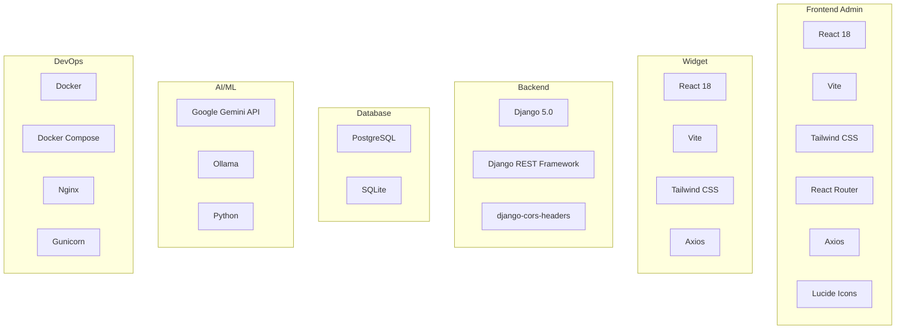

# Tech Stack

## Overview

The IWP Chatbot is built using modern, production-ready technologies across the full stack.

## Technology Stack Diagram



## Frontend Technologies

### Admin Dashboard
| Technology | Version | Purpose |
|------------|---------|---------|
| [React](https://react.dev/) | 18.2.0 | UI framework |
| [Vite](https://vitejs.dev/) | 5.0.8 | Build tool and dev server |
| [React Router DOM](https://reactrouter.com/) | 6.20.0 | Client-side routing |
| [Tailwind CSS](https://tailwindcss.com/) | 3.3.6 | Utility-first CSS framework |
| [Axios](https://axios-http.com/) | 1.6.2 | HTTP client |
| [Lucide React](https://lucide.dev/) | 0.294.0 | Icon library |

### Embeddable Widget
| Technology | Version | Purpose |
|------------|---------|---------|
| [React](https://react.dev/) | 18.2.0 | UI framework |
| [Vite](https://vitejs.dev/) | 5.0.8 | Build tool with library mode |
| [Tailwind CSS](https://tailwindcss.com/) | 3.3.6 | Styling |
| [Axios](https://axios-http.com/) | 1.6.2 | API communication |
| [Lucide React](https://lucide.dev/) | 0.294.0 | Icons |

## Backend Technologies

| Technology | Version | Purpose |
|------------|---------|---------|
| [Python](https://www.python.org/) | 3.11+ | Programming language |
| [Django](https://www.djangoproject.com/) | 5.0.7 | Web framework |
| [Django REST Framework](https://www.django-rest-framework.org/) | 3.14.0 | API framework |
| [django-cors-headers](https://github.com/adamchainz/django-cors-headers) | 4.3.1 | CORS handling |
| [python-decouple](https://github.com/HBNetwork/python-decouple) | 3.8 | Environment configuration |
| [requests](https://requests.readthedocs.io/) | 2.31.0 | HTTP requests for AI APIs |
| [gunicorn](https://gunicorn.org/) | 21.2.0 | WSGI server for production |

## Database

| Database | Use Case | Notes |
|----------|----------|-------|
| [PostgreSQL](https://www.postgresql.org/) | Production | Recommended for production deployments |
| [SQLite](https://www.sqlite.org/) | Development/Testing | Default for local development |

## AI & Machine Learning

| Service | Type | Purpose |
|---------|------|---------|
| [Google Gemini](https://ai.google.dev/) | Cloud API | Primary AI provider (gemini-3.5-flash-lite) |
| [Ollama](https://ollama.ai/) | Local LLM | Self-hosted AI option |
| Custom Fallback | Rule-based | Ensures availability without AI |

## DevOps & Deployment

| Tool | Purpose |
|------|---------|
| [Docker](https://www.docker.com/) | Containerization |
| [Docker Compose](https://docs.docker.com/compose/) | Multi-container orchestration |
| [Nginx](https://nginx.org/) | Reverse proxy and static file serving |
| [Git](https://git-scm.com/) | Version control |

## Development Tools

| Tool | Purpose |
|------|---------|
| [VS Code](https://code.visualstudio.com/) | IDE |
| [Postman](https://www.postman.com/) | API testing |
| [Django Admin](https://docs.djangoproject.com/en/stable/ref/contrib/admin/) | Quick admin interface |
| [Browser DevTools](https://developer.chrome.com/docs/devtools/) | Debugging |

## Dependencies Details

### Backend Requirements
```txt
Django==5.0.7
djangorestframework==3.14.0
django-cors-headers==4.3.1
python-decouple==3.8
requests==2.31.0
gunicorn==21.2.0
psycopg2-binary==2.9.9
```

### Frontend Dependencies
Key packages for admin dashboard:
- react, react-dom, react-router-dom
- axios
- lucide-react
- tailwindcss, postcss, autoprefixer

## Architecture Decisions

### Why Django REST Framework?
- Rapid development with batteries included
- Powerful ORM for database management
- Built-in admin interface
- Excellent security features
- Large ecosystem

### Why React + Vite?
- Fast development with hot module replacement
- Optimized production builds
- Component-based architecture
- Great ecosystem and community
- Easy integration

### Why Multi-Provider AI?
- Redundancy and high availability
- Cost optimization
- Flexibility to use local models
- Graceful degradation

### Why Tailwind CSS?
- Rapid UI development
- Consistent design system
- Small production bundle
- Easy customization

## Browser Support

- Chrome (latest)
- Firefox (latest)
- Safari (latest)
- Edge (latest)
- Mobile browsers (iOS Safari, Chrome Mobile)
